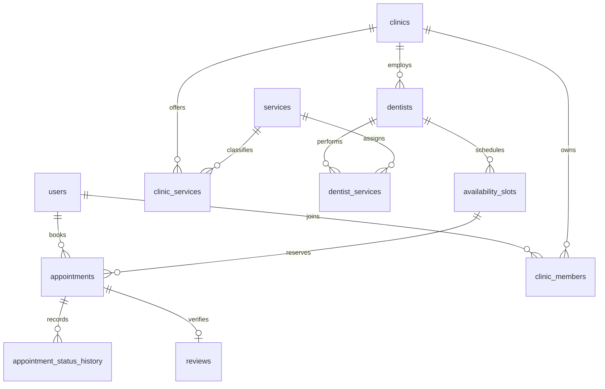

# База данных QLine
Источник схемы: `Backend/supabase/migrations/001_initial.sql`. Миграция не запускалась на Supabase в этой среде. Применять сначала к отдельному тестовому проекту.

| Таблица | Назначение и ключевые связи |
|---|---|
| users | Профиль, FK → auth.users; platform_admin/blocked меняются только оператором или защищённой RPC |
| clinics | Уникальный slug, city/district, approved; нет демонстрационных клиник в миграции |
| clinic_members | PK(user_id, clinic_id), owner/administrator/dentist; составной FK врача в той же клинике |
| dentists | Врачи клиники, две локали имени |
| services | Категории услуг RU/KZ; price — начальное значение редактора, не тариф клиники |
| clinic_services | PK(clinic_id, service_id), фактическая цена и длительность |
| dentist_services | PK(dentist_id, service_id), услуги конкретного врача |
| working_hours | Рабочие шаблоны, UNIQUE(dentist_id, weekday) |
| blocked_slots | Перерывы/выходные, интервалы timestamptz |
| availability_slots | Явно опубликованные слоты; исключение пересечений открытых слотов врача |
| appointments | Пациент, клиника, врач, услуга, слот; согласие и ключ идемпотентности |
| appointment_status_history | Старый/новый статус, автор, время; триггер |
| reviews | FK на уникальный приём, verified; сбор отзывов ещё не включён |
| notifications | Очередь событий; отправщик SMS/email не подключён |
| notification_settings | Сохранённые предпочтения клиники |
| audit_logs | Автор, действие, объект, время; прямые записи из клиента запрещены |
| complaints | Обращения для модерации; внешний канал ещё не подключён |
| runtime_settings | Утверждённая версия согласия и флаг legal_approved; доступен только оператору |

RLS включена на каждой таблице. У пациента SELECT только собственных приёмов; у менеджера — своей клиники; у врача — назначенных ему. Публичная выдача слотов не содержит сведений пациентов. Все изменения идут через `qline_api`, которая получает пользователя через `auth.uid()`, проверяет блокировку/роль и не принимает клиентский user_id. В Express используется anon key вместе с пользовательским access token; service_role не требуется.

Защита записи: транзакция, advisory-lock для ключа идемпотентности и врача, блокировка строки слота, повторная проверка доступности, GiST EXCLUDE для интервалов pending/confirmed. Отмена освобождает интервал. Подтверждённый визит завершает только сотрудник после начала приёма. Перенос меняет приём атомарно; запрос пациента его не перемещает.

Индексы: город/район опубликованных клиник, пациент/дата, клиника/дата, услуга/дата слота, участники, история, аудит. Пересечения интервалов используют полуоткрытые диапазоны `[start,end)`, поэтому последовательные приёмы допустимы.

Шаблоны рабочих часов сохраняются отдельно и ограничивают допустимые слоты, если заданы для врача. Изменение часов, перекрывающее действующие будущие приёмы, отклоняется. Открытие времени — явное действие администратора, а не автоматическая генерация. Перерывы и выходные задаются блокировками. Автоматический генератор из шаблонов — отдельное последующее улучшение.

Проверка: `npm run test:db` в отдельном Supabase-проекте. SQL-фикстуры синтетические, транзакция откатывается. Для реального конкурентного теста нужны два соединения: одновременно POST одного slot_id с разными пациентами и ключами, ожидание одного успеха и одного 409. Один SQL-сеанс этого не доказывает.
